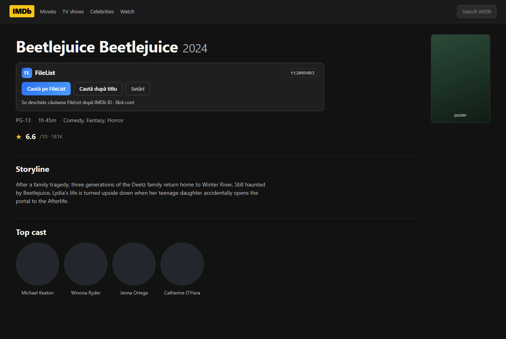
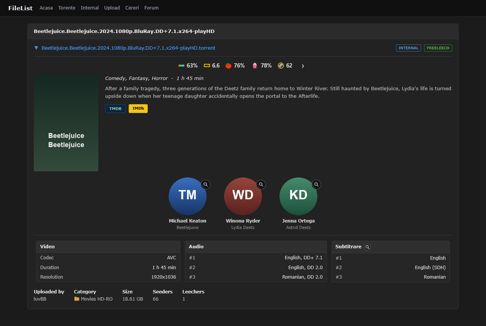
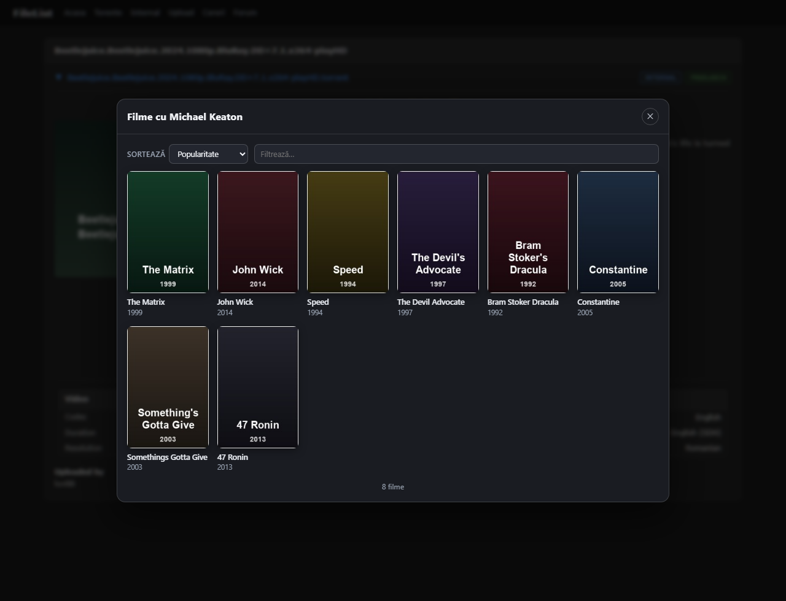
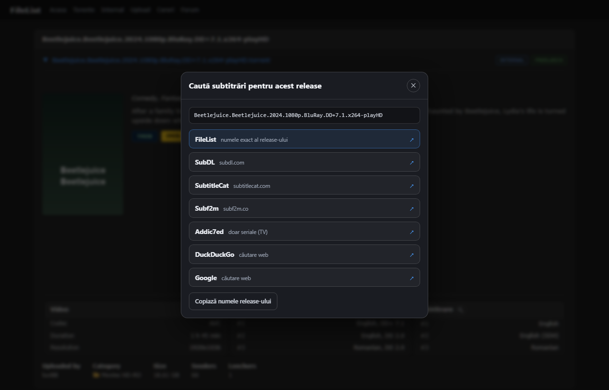
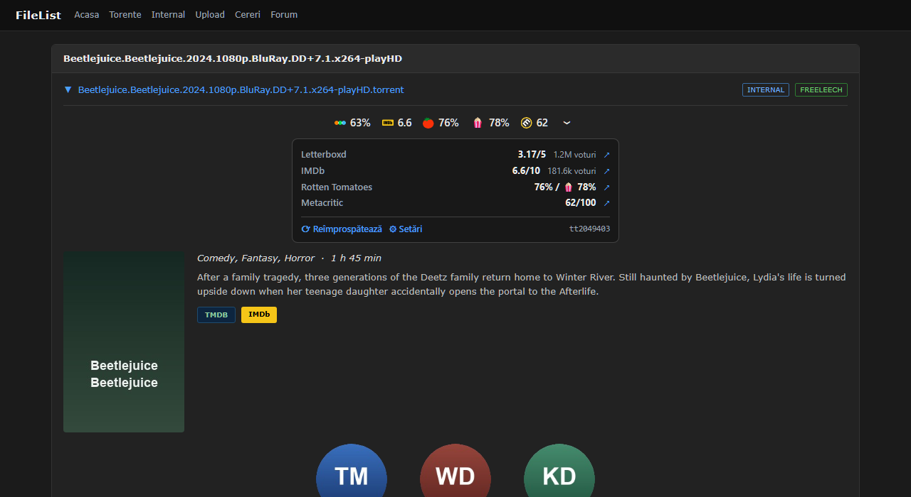
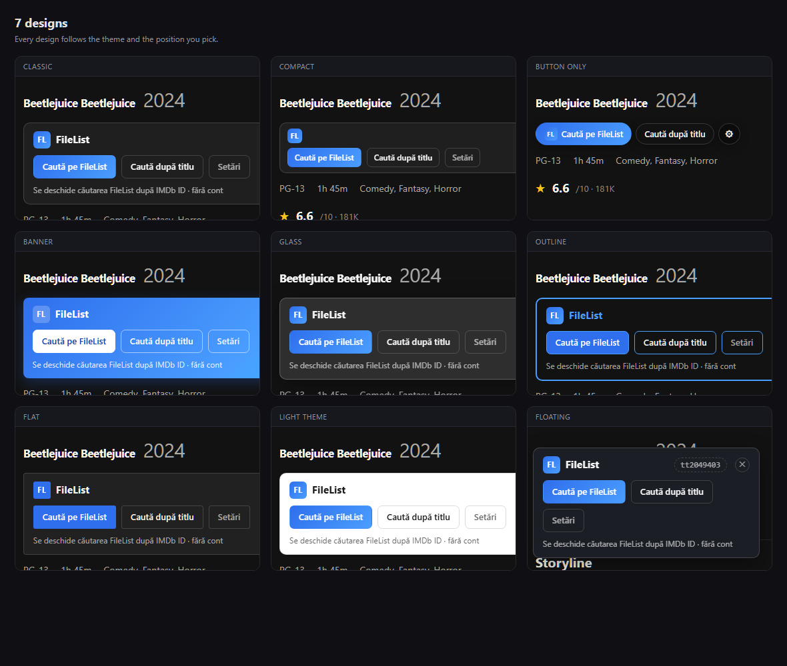
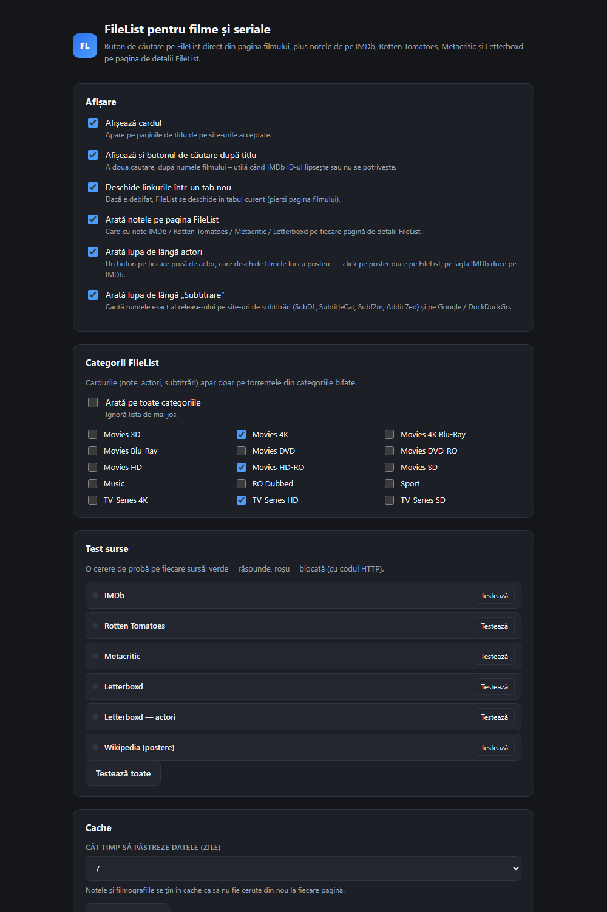
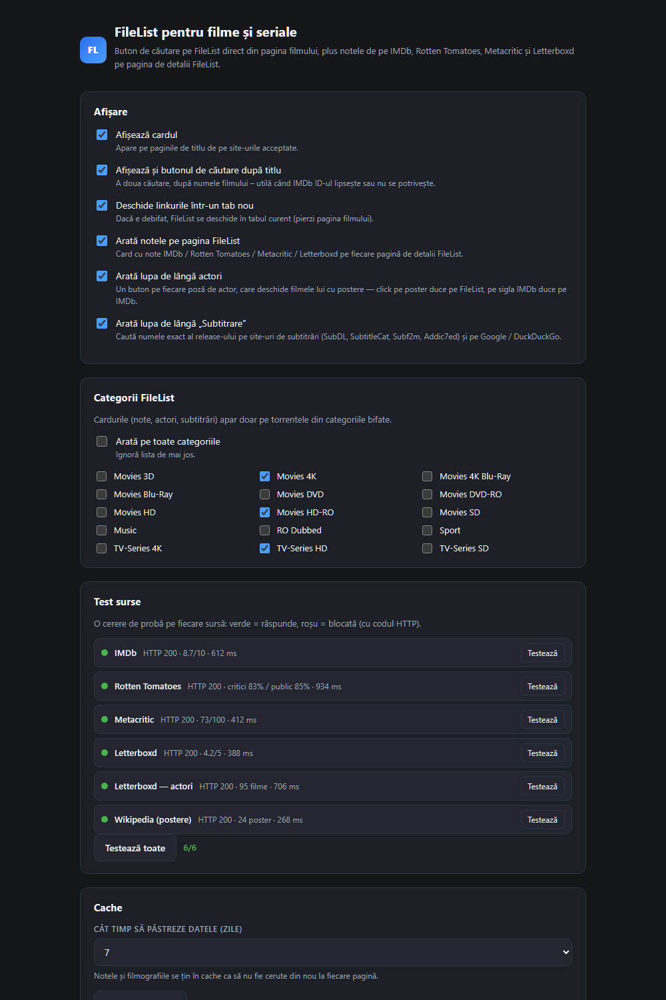
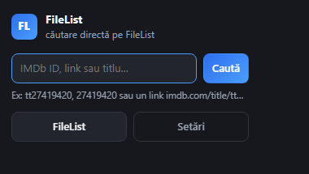

<h1 align="center">FileList for Movies &amp; Shows</h1>

<p align="center">
  <b>From a movie page to FileList in one click — and from FileList to IMDb, Rotten Tomatoes, Metacritic, Letterboxd, actor filmographies and subtitles.</b><br>
  <sub>Chrome extension · Manifest V3 · no account, no API keys</sub>
</p>

<p align="center">
  
  
  
  
  
</p>

<p align="center">
  <a href="#english">🇬🇧 English</a> &nbsp;·&nbsp; <a href="#romana">🇷🇴 Română</a>
</p>

---

<a id="english"></a>

## 🇬🇧 English

### What it does

Four things, in both directions between the movie databases and FileList:

| | Feature | Where |
|:--:|:--|:--|
| 🎬 | **Search card** — a button that opens the FileList search for the movie you are looking at | IMDb, Rotten Tomatoes, Letterboxd, TMDB, TheTVDB, Trakt, Metacritic, AlloCiné, FilmAffinity |
| ⭐ | **Ratings row** — IMDb, Rotten Tomatoes, Metacritic and Letterboxd scores side by side | FileList torrent pages |
| 👤 | **Actor filmography** — a magnifier on every cast photo opens the actor's films with posters | FileList torrent pages |
| 💬 | **Subtitle search** — a magnifier next to the subtitles column searches the exact release name | FileList torrent pages |

No account and no API keys are required: everything is built from public pages, opened in your own browser where
you are already logged in.

## 📸 Screenshots

<p align="center">
  <br>
  <sub><b>Search card</b> — right under the title on IMDb, Rotten Tomatoes, Letterboxd, TMDB, Trakt and more</sub>
</p>

<p align="center">
  <br>
  <sub><b>Ratings row</b> — Letterboxd, IMDb, Rotten Tomatoes and Metacritic on every FileList torrent page</sub>
</p>

<table>
  <tr>
    <td width="50%"><br>
      <sub><b>Actor filmography</b> — magnifier on every cast photo, with sort &amp; filter</sub></td>
    <td width="50%"><br>
      <sub><b>Subtitle search</b> — the exact release name on 7 sites</sub></td>
  </tr>
  <tr>
    <td><br>
      <sub><b>Ratings details</b> — exact values, votes and links</sub></td>
    <td><br>
      <sub><b>7 designs</b> — card, compact, button, banner, glass, outline, flat</sub></td>
  </tr>
  <tr>
    <td><br>
      <sub><b>Settings</b> — every switch, category filter, cache</sub></td>
    <td><br>
      <sub><b>Source test</b> — one probe per source, with HTTP code and latency</sub></td>
  </tr>
</table>

<p align="center">
  <br>
  <sub><b>Popup</b> — quick search by IMDb ID, link or title</sub>
</p>

> The screenshots are rendered with the extension's own components on demo pages (no real site content), so they
> show exactly what the UI looks like without exposing anyone's account.
### 🎬 Search card on movie sites

The card reads the page, extracts the IMDb ID (URL → IMDb links → JSON-LD → meta tags) and builds
`filelist.io/browse.php?search=…`. When there is no IMDb ID it falls back to the original title, then to the
displayed title. *Search on FileList* opens the search; the small chip copies the IMDb ID.

- **9 sites** supported out of the box (see the table above)
- **7 designs** — card, compact, button only, colored bar, glass, outline, flat
- **7 positions** — below / above the title, after the title block, fixed top / bottom bar, floating right / left
- **3 themes** — auto (matches the page), dark, light
- **2 languages** — Romanian and English

### ⭐ Ratings on FileList

```
🔵🟠🔵 71%   [IMDb] 6.6   🍅 76%   🍿 78%   [M] 62   ›
```

Click a score to open the source; the arrow expands exact values, vote counts and links.

| Score | Source |
|:--|:--|
| IMDb | `aggregateRating` from the IMDb title page (JSON-LD) |
| Rotten Tomatoes | critic + audience score from the RT search page rows, audience from the film page |
| Metacritic | `backend.metacritic.com` search, matched by IMDb ID or title + year |
| Letterboxd | `letterboxd.com/imdb/<id>/` redirect → rating |

Scores are cached (1 / 2 / 5 / 7 / 14 / 24 days, your choice) and refreshed with the ⟳ button. If a source is
unavailable, a quiet line tells you why: `No score: Rotten Tomatoes (http-403)`.

### 👤 Actor filmography

Every cast photo gets a magnifier. Click it to open the actor's films with posters (up to 24), sorted and filterable:

- data: film list from the **Letterboxd** actor page, posters from **Wikipedia** (`pageimages`)
- click a poster → FileList search for that film · IMDb badge → the film on IMDb
- sort by popularity / year / title and filter by name right inside the panel

### 💬 Subtitle search

The subtitles column header gets a magnifier that searches the **exact release name**
(`Spider-Man.2.2004.1080p.BluRay.DD+7.1.x264-playHD`) on: **FileList**, **SubDL**, **SubtitleCat**, **Subf2m**,
**Addic7ed** (TV shows), **DuckDuckGo** and **Google** — plus a button that copies the release name.

### ⚙️ Settings

| Section | Options |
|:--|:--|
| Display | card on/off, search-by-title button, open in new tab, ratings row, actor magnifier, subtitle magnifier |
| **FileList categories** | the cards only appear on checked categories (Movies / TV-Series / …); or “show on all categories” |
| Look & language | language (RO/EN), theme (auto/dark/light), design (7), position (7) |
| **Source test** | one probe request per source (IMDb, RT, Metacritic, Letterboxd, Letterboxd actors, Wikipedia) with HTTP code, detail and latency; “Test all” shows `5/6` |
| **Cache** | retention 1–24 days + a global “Clear the cache” button |

Settings save instantly.

### 🚀 Install

1. Download this repository (`Code → Download ZIP`) and unzip it.
2. Open `chrome://extensions/` → enable **Developer mode**.
3. **Load unpacked** → select the folder that contains `manifest.json`.
4. Open a movie page or `https://filelist.io/details.php?id=…`.

> You must be logged in on `filelist.io` in the same browser — the extension only builds links, it never handles
> your credentials.

### ⌨️ Shortcuts & context menu

| Action | How |
|:--|:--|
| Search the current movie page on FileList | `Alt+F` |
| Open the actor filmography panel | `Alt+A` (on a FileList page) |
| Search any selected text on FileList | right click → *Search “…” on FileList* |
| Close a panel | `Esc` |

### 🔒 Privacy

- No account, no passkey, no API key is ever requested or stored.
- Settings and caches live in `chrome.storage.local` only.
- Ratings and filmographies are read from public pages (IMDb, Rotten Tomatoes, Metacritic, Letterboxd, Wikipedia)
  with your browser cookies, exactly what you would see by opening them yourself.
- Every feature can be switched off in the settings.

### 🗂 Project structure

```
filelist-imdb/
├── manifest.json          MV3 manifest (permissions, content scripts, DNR rules)
├── background.js          service worker: ratings, actor films, source tests, cache, context menu
├── lib/shared.js          site registry, IMDb ID detection, i18n (RO/EN), parsers, settings
├── content/
│   ├── fl-panel.js/.css   search card on movie sites (7 designs × 7 positions × 3 themes)
│   ├── fl-details.js      ratings row on FileList pages
│   ├── fl-ratings.css
│   ├── fl-actors.js/.css  cast magnifier + filmography panel
│   └── fl-subs.js         subtitle magnifier + site list
├── rules/rt-headers.json  declarativeNetRequest header fix for Rotten Tomatoes
├── icons/                 extension icons + source logos (IMDb, RT, Letterboxd, Metacritic)
├── screenshots/           the images used in this README
├── options.html/.css/.js  settings page (RO/EN)
└── popup.html/.css/.js    quick search popup
```

No build step, no dependencies — the folder itself is the extension.

### 🧩 Adding a new site

1. `manifest.json` → `content_scripts[0].matches`;
2. `lib/shared.js` → the `SITES` array: `{ id, label, host, path, titleSelectors, containerSelectors, suffixes }`.

`containerSelectors` is the block the card is inserted after, for sites where the title sits inside an overlay or a
framework-managed subtree.

### ⚠️ Known limitations

- Rotten Tomatoes and IMDb sit behind bot protection; on some networks a request returns `403` / `404` / `202`.
  The ratings row degrades gracefully and the **Source test** page tells you which one is failing.
- Subtitle site URLs change from time to time — OpenSubtitles and Podnapisi were dropped for that reason.
- Category detection is strict: if the category cannot be read, nothing is injected (use “show on all categories”
  to override).
- Ratings are series-level for TV episodes.

---

<a id="romana"></a>

## 🇷🇴 Română

### Ce face

Patru lucruri, în ambele direcții între bazele de date de film și FileList:

| | Funcție | Unde |
|:--:|:--|:--|
| 🎬 | **Card de căutare** — un buton care deschide căutarea FileList pentru filmul din pagină | IMDb, Rotten Tomatoes, Letterboxd, TMDB, TheTVDB, Trakt, Metacritic, AlloCiné, FilmAffinity |
| ⭐ | **Rând de note** — IMDb, Rotten Tomatoes, Metacritic și Letterboxd una lângă alta | paginile de torrent FileList |
| 👤 | **Filmografia actorului** — lupă pe fiecare poză de actor, cu filmele lui și postere | paginile de torrent FileList |
| 💬 | **Căutare subtitrări** — lupă lângă coloana de subtitrări, după numele exact al release-ului | paginile de torrent FileList |

Nu ai nevoie de cont sau de chei API: totul se construiește din pagini publice, deschise în browserul tău, unde
ești deja logat.

### 📸 Capturi de ecran

<p align="center">
  <br>
  <sub><b>Cardul de căutare</b> — direct sub titlu pe IMDb, Rotten Tomatoes, Letterboxd, TMDB, Trakt și altele</sub>
</p>

<p align="center">
  <br>
  <sub><b>Rândul de note</b> — Letterboxd, IMDb, Rotten Tomatoes și Metacritic pe fiecare pagină de torrent</sub>
</p>

<table>
  <tr>
    <td width="50%"><br>
      <sub><b>Filmografia actorului</b> — lupă pe fiecare poză, cu sortare și filtrare</sub></td>
    <td width="50%"><br>
      <sub><b>Căutare subtitrări</b> — numele exact al release-ului pe 7 site-uri</sub></td>
  </tr>
  <tr>
    <td><br>
      <sub><b>Detaliile notelor</b> — valori exacte, voturi și linkuri</sub></td>
    <td><br>
      <sub><b>7 designuri</b> — card, compact, buton, banner, sticlă, contur, flat</sub></td>
  </tr>
  <tr>
    <td><br>
      <sub><b>Setările</b> — fiecare opțiune, filtrarea pe categorii, cache</sub></td>
    <td><br>
      <sub><b>Test surse</b> — o cerere de probă per sursă, cu cod HTTP și durată</sub></td>
  </tr>
</table>

<p align="center">
  <br>
  <sub><b>Popup</b> — căutare rapidă după IMDb ID, link sau titlu</sub>
</p>

> Capturile sunt randate cu componentele extensiei pe pagini demonstrative (fără conținut real de pe site-uri), deci
> arată exact cum apare interfața, fără să expună contul nimănui.
### 🎬 Cardul pe site-urile de filme

Cardul citește pagina, scoate IMDb ID-ul (URL → linkuri IMDb → JSON-LD → meta taguri) și construiește
`filelist.io/browse.php?search=…`. Dacă nu găsește ID-ul, caută după titlul original, apoi după titlul afișat.
*Caută pe FileList* deschide căutarea; pastila mică copiază IMDb ID-ul.

- **9 site-uri** acceptate din start (tabelul de mai sus)
- **7 designuri** — card, compact, doar buton, bară colorată, sticlă, doar contur, flat
- **7 poziții** — sub / deasupra titlului, după blocul titlului, bară fixă sus / jos, plutitor dreapta / stânga
- **3 teme** — automat (după pagină), întunecat, luminos
- **2 limbi** — română și engleză

### ⭐ Notele pe FileList

```
🔵🟠🔵 71%   [IMDb] 6.6   🍅 76%   🍿 78%   [M] 62   ›
```

Click pe o notă deschide sursa; săgeata extinde valorile exacte, numărul de voturi și linkurile.

| Notă | Sursa |
|:--|:--|
| IMDb | `aggregateRating` din pagina filmului (JSON-LD) |
| Rotten Tomatoes | critici + public din rândurile paginii de căutare RT, publicul din pagina filmului |
| Metacritic | căutare pe `backend.metacritic.com`, potrivire după IMDb ID sau titlu + an |
| Letterboxd | redirect `letterboxd.com/imdb/<id>/` → notă |

Notele se țin în cache (1 / 2 / 5 / 7 / 14 / 24 de zile, cum alegi) și se refac cu ⟳. Dacă o sursă nu răspunde,
o linie discretă îți spune de ce: `Fără notă: Rotten Tomatoes (http-403)`.

### 👤 Filmografia actorului

Fiecare poză de actor primește o lupă. Click → filmele actorului cu postere (până la 24), cu sortare și filtrare:

- date: lista de filme de pe pagina de actor **Letterboxd**, posterele de pe **Wikipedia** (`pageimages`)
- click pe poster → căutarea FileList pentru filmul respectiv · sigla IMDb → filmul pe IMDb
- sortare după popularitate / an / titlu și filtru după nume, direct în panou

### 💬 Căutarea de subtitrări

Coloana de subtitrări primește o lupă care caută **numele exact al release-ului**
(`Spider-Man.2.2004.1080p.BluRay.DD+7.1.x264-playHD`) pe: **FileList**, **SubDL**, **SubtitleCat**, **Subf2m**,
**Addic7ed** (seriale), **DuckDuckGo** și **Google** — plus un buton care copiază numele release-ului.

### ⚙️ Setări

| Secțiune | Opțiuni |
|:--|:--|
| Afișare | card on/off, buton „caută după titlu”, deschide în tab nou, rând de note, lupă actori, lupă subtitrări |
| **Categorii FileList** | cardurile apar doar în categoriile bifate (Movies / TV-Series / …); sau „arată pe toate categoriile” |
| Aspect și limbă | limba (RO/EN), temă (auto/întunecat/luminos), design (7), poziție (7) |
| **Test surse** | o cerere de probă per sursă (IMDb, RT, Metacritic, Letterboxd, Letterboxd actori, Wikipedia) cu cod HTTP, detaliu și durată; „Testează toate” arată `5/6` |
| **Cache** | păstrare 1–24 de zile + buton global „Golește cache-ul” |

Setările se salvează instant.

### 🚀 Instalare

1. Descarcă repository-ul (`Code → Download ZIP`) și dezarhivează.
2. Deschide `chrome://extensions/` → activează **Developer mode**.
3. **Load unpacked** → alege folderul care conține `manifest.json`.
4. Deschide o pagină de film sau `https://filelist.io/details.php?id=…`.

> Trebuie să fii logat pe `filelist.io` în același browser — extensia doar construiește linkuri, nu umblă la
> credențialele tale.

### ⌨️ Scurtături și meniu contextual

| Acțiune | Cum |
|:--|:--|
| Caută pagina curentă pe FileList | `Alt+F` |
| Deschide panoul cu filmele actorului | `Alt+A` (pe o pagină FileList) |
| Caută orice text selectat pe FileList | click dreapta → *Caută „…” pe FileList* |
| Închide un panou | `Esc` |

### 🔒 Confidențialitate

- Nu se cer și nu se stochează cont, passkey sau chei API.
- Setările și cache-urile stau doar în `chrome.storage.local`.
- Notele și filmografiile se citesc din pagini publice (IMDb, Rotten Tomatoes, Metacritic, Letterboxd, Wikipedia)
  cu cookie-urile browserului tău — exact ce ai vedea deschizându-le singur.
- Fiecare funcție poate fi oprită din setări.

### 🗂 Structura proiectului

```
filelist-imdb/
├── manifest.json          manifest MV3 (permisiuni, content scripts, reguli DNR)
├── background.js          service worker: note, filmele actorilor, test surse, cache, meniu contextual
├── lib/shared.js          registru de site-uri, detectare IMDb ID, traduceri (RO/EN), parsere, setări
├── content/
│   ├── fl-panel.js/.css   cardul de căutare pe site-urile de filme (7 designuri × 7 poziții × 3 teme)
│   ├── fl-details.js      rândul de note pe paginile FileList
│   ├── fl-ratings.css
│   ├── fl-actors.js/.css  lupa de lângă actori + panoul cu filmografia
│   └── fl-subs.js         lupa de la subtitrări + lista de site-uri
├── rules/rt-headers.json  regulă declarativeNetRequest pentru Rotten Tomatoes
├── icons/                 iconițele extensiei + logo-urile sursă (IMDb, RT, Letterboxd, Metacritic)
├── screenshots/           imaginile folosite în acest README
├── options.html/.css/.js  pagina de setări (RO/EN)
└── popup.html/.css/.js    fereastra de căutare rapidă
```

Fără build, fără dependențe — folderul este extensia.

### 🧩 Cum adaugi un site nou

1. `manifest.json` → `content_scripts[0].matches`;
2. `lib/shared.js` → array-ul `SITES`: `{ id, label, host, path, titleSelectors, containerSelectors, suffixes }`.

`containerSelectors` este blocul după care se inserează cardul, pentru site-uri unde titlul stă într-un layer cu
overlay sau într-un component re-randat de framework.

### ⚠️ Limitări cunoscute

- Rotten Tomatoes și IMDb au protecție anti-bot; pe unele rețele cererile întorc `403` / `404` / `202`. Rândul de
  note degradează frumos, iar pagina **Test surse** îți spune exact care sursă pică.
- URL-urile site-urilor de subtitrări se schimbă din când în când — de aceea OpenSubtitles și Podnapisi au fost scoase.
- Detectarea categoriei e strictă: dacă nu poate fi citită, nu se injectează nimic (poți forța cu „arată pe toate
  categoriile”).
- La seriale, notele sunt cele ale serialului, nu ale episodului.

---

## 📄 License

[MIT](LICENSE) © zyggy123

<p align="center">
  <sub>made up by <b>zyggy123</b></sub>
</p>
